# 配信ダッシュボード：スクリーンショット付き操作ガイド

[English](GUIDE.md) | [简体中文](GUIDE.zh-CN.md) | **日本語**

このガイドでは、ダッシュボードの起動からチャットの受信・送信、翻訳、読み上げ、OBS、分析までを順番に説明します。

> **画像について**
> 2026年10月15日の日本語 UI を撮影しています。撮影用セッションは未ログイン・受信停止中のため、チャットやグラフは空です。実際の配信・ギフト・文字起こし結果を示す画像ではありません。ルームのカバー画像は非表示にし、保存済みフィルターの内容は伏せています。表示内容や利用できる項目は、接続環境・設定・画面幅によって変わります。

## まず覚える操作

| 場所 | できること |
|---|---|
| 上部のページ入口 | 配信モニタリング、チャット、文字起こし、OBS、分析、フィルター、Cookie の切り替え |
| 左上の ☰ | 言語・タイムゾーン・翻訳・文字サイズ・読み上げの設定 |
| チャット画面の下部 | スタンプ選択、メッセージ入力、送信先の選択、送信 |

ページ入口は **Deploy と同じ上部バー** にあります。狭い画面では入口を横スクロールしてください。☰ は設定用のドロワーを開閉します。Escape キーでも閉じられます。

**文字起こしは既定で非表示**です。表示方法は [手順8](#手順8任意ライブ音声を文字起こしする) を参照してください。

## 手順1：Windows で起動する

1. [リポジトリ](https://github.com/OneJan111/multi-platform-chat) の **Code → Download ZIP** から取得します。
2. ZIP を右クリックして **すべて展開** します。ZIP 内から直接起動しないでください。
3. 展開先の `Start_Dashboard.bat` をダブルクリックします。
4. 初回は Python と依存パッケージの準備が完了するまで待ちます。
5. ブラウザーでダッシュボードが開いたことを確認します。通常の起動先は <http://localhost:8501> です。

ダッシュボードを使用中は、起動した黒いウィンドウを閉じないでください。最小化は可能です。画像撮影時は開発用の別ポートを使用していますが、操作は同じです。

## 手順2：配信モニタリングで受信を開始する

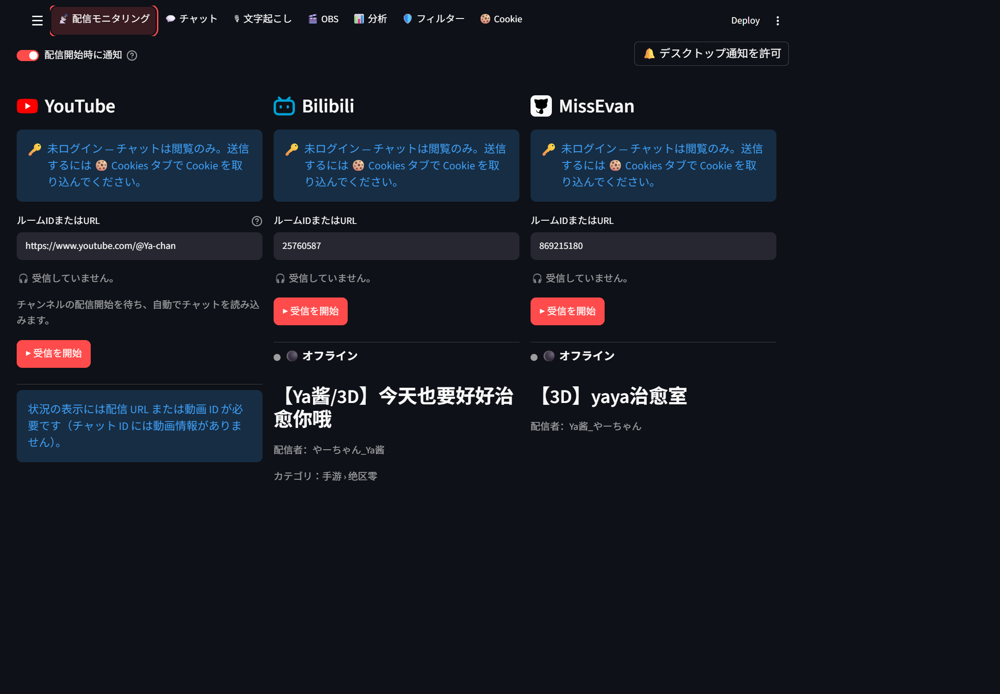

1. 上部の **配信モニタリング** を選びます。新しいセッションでは最初にこの画面が開きます。
2. YouTube、Bilibili、MissEvan の使いたい列を探します。
3. **ルームIDまたはURL** に自分が見たい配信の URL またはルーム番号を入力します。画像内の値は例です。
4. **▶ 受信を開始** を押します。
5. 受信状態を確認します。接続中と受信中は表示が異なります。
6. 上部の **チャット** に切り替えてメッセージを見ます。受信中のルームがあると、モニタリング画面にも切り替え案内が表示されます。

- 閲覧だけならサイトへのログインは不要です。
- YouTube のチャンネル URL を使った場合は、配信開始を待ってチャットを読み込みます。待機中は、まだチャットを受信していない場合があります。
- 止めるときは対象サイトの **受信を停止** を押します。
- **配信開始時に通知** は配信開始の通知設定です。デスクトップ通知を使う場合は、右上の **デスクトップ通知を許可** を押し、ブラウザー側でも許可します。

## 手順3：チャットとギフトを見る

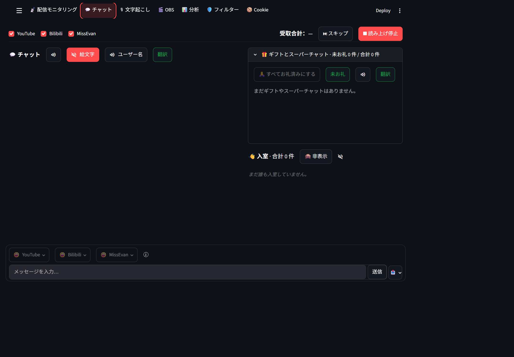

1. 上部の **チャット** を選びます。
2. YouTube / Bilibili / MissEvan のチェックで、表示するサイトを選びます。
3. 通常チャットと **ギフトとスーパーチャット** を確認します。狭い画面では縦に並びます。
4. 最新メッセージは設定した表示順の先頭または末尾へ自動追従します。
5. 過去のメッセージへスクロールすると自動追従が一時停止します。最新位置へ戻るか、スクロール中に現れる矢印を押すと再開します。

### ギフトへのお礼を管理する

1. **ギフトまたはスーパーチャットの内容部分全体** をクリックすると、お礼済みになります。
2. 同じ項目をもう一度クリックすると取り消せます。
3. **未お礼** を押すと、まだお礼していない項目だけを表示します。緑の塗りつぶしはオン、緑の枠線はオフです。
4. **すべてお礼済みにする** は、表示対象サイトの未お礼項目をまとめて処理します。

項目横の読み上げ・ブロックボタンは独立した操作です。お礼操作とは区別してください。

## 手順4：☰ で翻訳・表示・読み上げを設定する

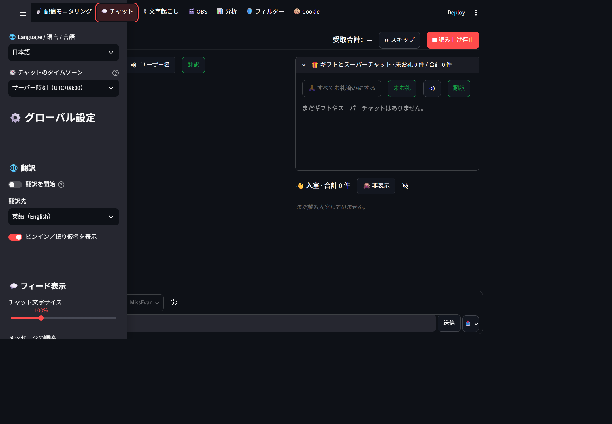

### 表示言語とチャット時刻

1. 左上の **☰** を押します。
2. **Language / 语言 / 言語** で日本語を選びます。
3. **チャットのタイムゾーン** を必要に応じて変更します。
4. ドロワー内を下へスクロールし、**チャット文字サイズ** と **メッセージの順序** を選びます。

### チャットを翻訳する

1. **翻訳先** で日本語などの目的の言語を選びます。
2. **翻訳を開始** をオンにします。
3. ☰ または Escape で閉じ、チャットへ戻ります。
4. 原文が先に表示され、翻訳が完了すると後の更新で訳文が追加されます。

翻訳が遅れていても、原文の表示は翻訳完了を待ちません。翻訳対象のテキストは翻訳サービスへ送られます。

### 読み上げを使う

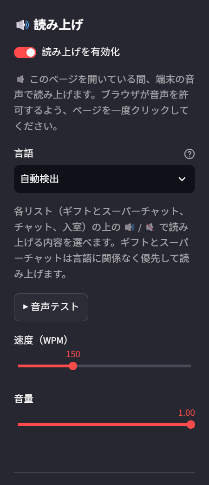

1. ドロワーを下へスクロールして **読み上げを有効化** をオンにします。
2. 言語・速度・音量を設定します。
3. **音声テスト** で音が出るか確認します。ブラウザーの音声許可のため、最初に画面をクリックする必要がある場合があります。
4. チャット画面へ戻り、次のボタンを使います。

| ボタン | 操作 |
|---|---|
| スピーカーのみ | そのリストの読み上げをミュート／解除 |
| スピーカー＋絵文字 | 有効時は絵文字やスタンプを読み飛ばす |
| スピーカー＋ユーザー名 | 有効時は通常チャットのユーザー名を読み飛ばす |
| チャット側の翻訳 | 通常チャットの訳文を読み上げる |
| ギフト側の翻訳 | スーパーチャットの訳文を読み上げる。ギフトの商品名は翻訳しない |
| スキップ | 現在の読み上げを飛ばす |
| 読み上げ停止 | 読み上げと待機中のキューを止める |

**これらの読み上げボタンは、読み上げを有効にしたときだけ表示されます。**

翻訳読み上げは、読み上げ言語が自動検出、または翻訳先と一致する場合に使われます。翻訳ボタンは緑の塗りつぶしがオン、緑の枠線がオフです。訳文待ちの読み上げは保留されますが、新しいチャットの表示は止まりません。

## 手順5：Cookie を取り込んで送信する（任意）

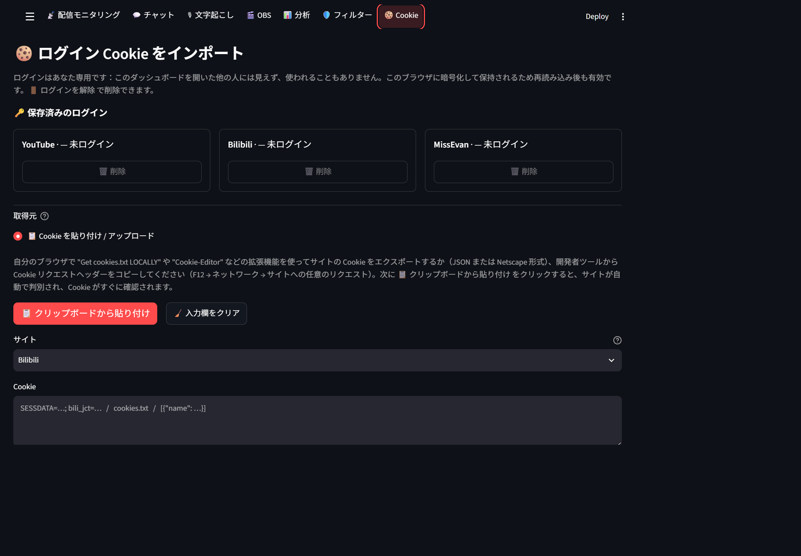

1. 普段のブラウザーで、送信したいサイトに自分のアカウントでログインします。
2. ダッシュボード上部の **Cookie** を選びます。
3. 自分のブラウザーから Cookie を JSON または Netscape 形式でエクスポートします。
4. **クリップボードから貼り付け**、Cookie 欄への貼り付け、またはファイルのアップロードを使います。

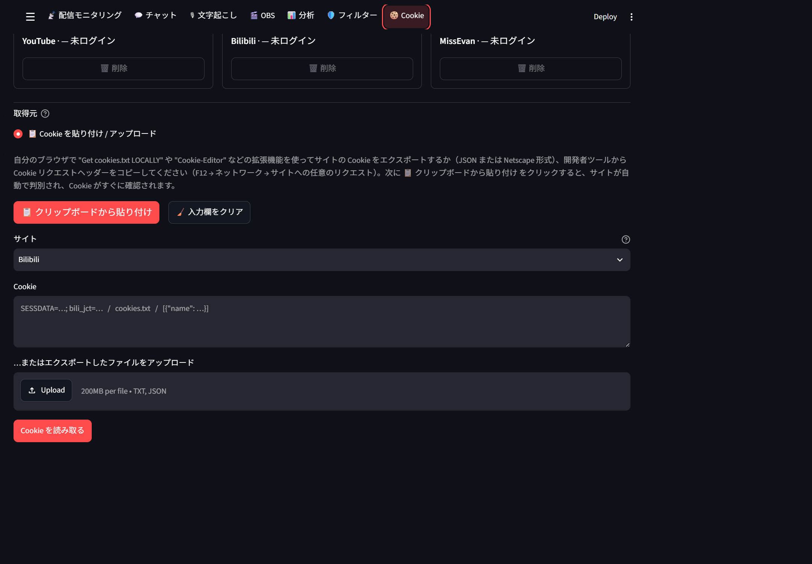

5. 必要に応じてサイトを選び、**Cookie を読み取る** を押します。クリップボード貼り付けでは自動判定・確認が行われます。
6. 表示される確認結果に従って取り込みを完了し、保存済みログインを確認します。
7. **配信モニタリング** で該当ルームの受信を開始します。
8. **チャット** 下部の入力欄にメッセージを入れ、右の **📤** で送信先を確認して **送信** を押します。

> Cookie はパスワードと同様に扱ってください。チャット、スクリーンショット、公開リポジトリへ貼らないでください。このガイドの画像には実際の Cookie は含めていません。

### サイト専用スタンプ

- YouTube スタンプは入力欄へ追加し、送信ボタンで投稿します。
- Bilibili の専用スタンプと MissEvan のルームスタンプは、選択するとそのサイトへ直接送信されます。
- 利用条件・ログイン・受信状態によって選べないスタンプがあります。画像内では未ログインのため利用できません。

## 手順6：OBS にチャットを表示する

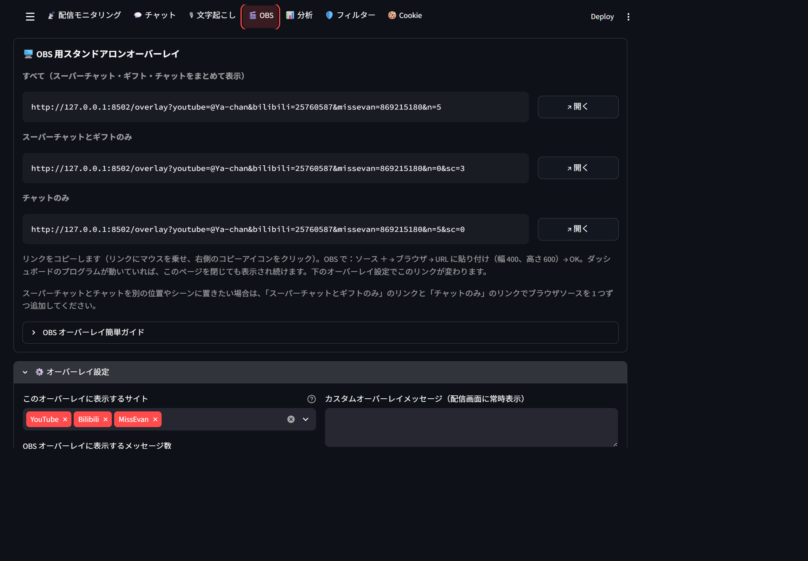

1. 上部の **OBS** を選びます。
2. **すべて**、**スーパーチャットとギフトのみ**、**チャットのみ** から使いたいリンクをコピーします。
3. OBS Studio の **ソース → ＋ → ブラウザ** を選びます。
4. コピーした URL を貼り付けます。初めは幅 **400**、高さ **600** を目安にし、レイアウトに合わせて調整します。
5. ダッシュボードの **オーバーレイ設定** で、表示サイト・メッセージ数・ユーザー名などを設定します。
6. ギフトと通常チャットを別々に配置したい場合は、専用リンクを使ってブラウザソースを2つ作ります。

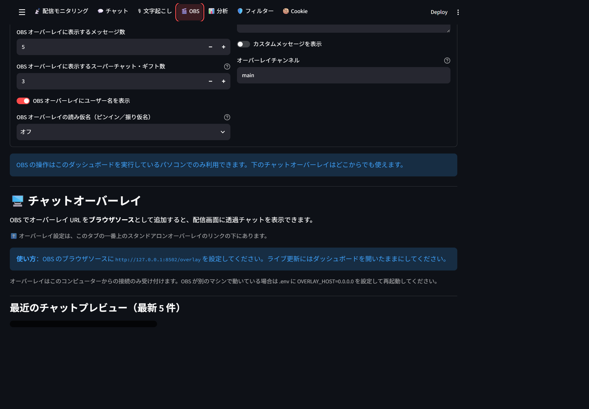

撮影時はポート8502のオーバーレイ URL が正常に応答することを確認しています。受信停止中のため、最近のチャットプレビューは空です。OBS Studio 内での表示確認は別途行ってください。

ポートの使用重複エラーが出た場合は、使用中の別ダッシュボードを確認するか、管理者が `.env` の `OVERLAY_PORT` を空いているポートに変更して再起動してください。再起動後に画面から URL をコピーし直します。

OBS 本体の操作パネルは利用環境によって表示されません。撮影環境ではローカル専用の OBS 操作は利用できないため、その接続成功画面は掲載していません。オーバーレイを使用中はダッシュボードのプログラムを動かしておいてください。

## 手順7：分析とフィルターを確認する

### 分析

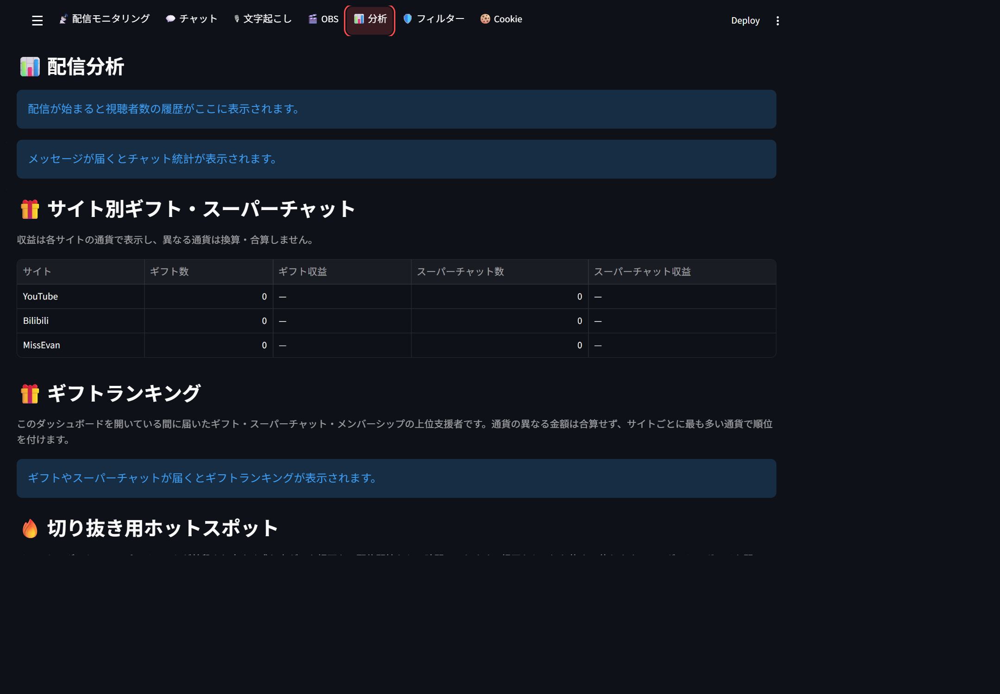

1. 受信を開始した状態で **分析** を開きます。
2. 視聴者数履歴とチャット統計を確認します。
3. **サイト別ギフト・スーパーチャット** で数量と収益を確認します。
4. **ギフトランキング** で支援者の集計を確認します。
5. **切り抜き用ホットスポット** を録画の見どころ探しに使います。

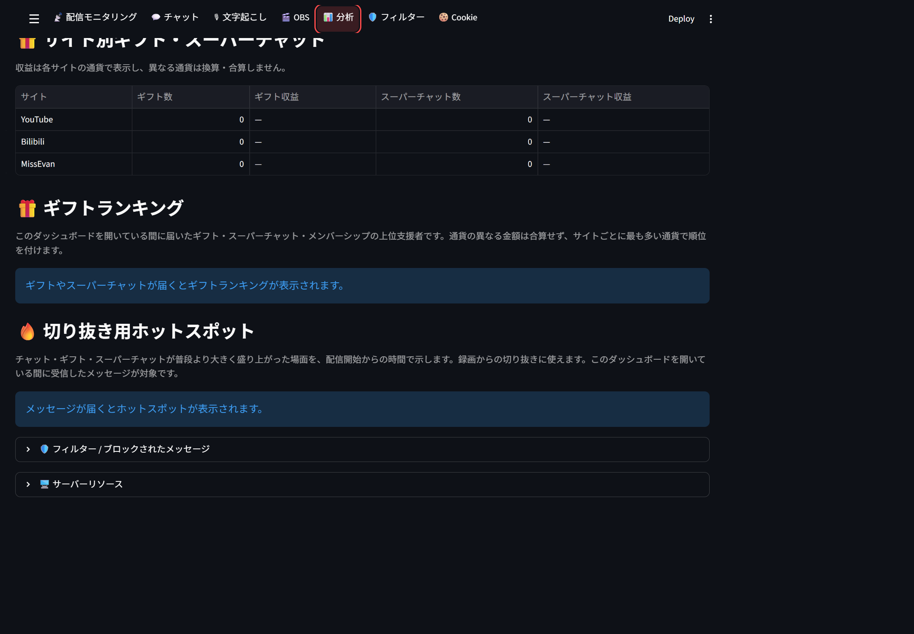

数値はこのダッシュボードで受信した内容が対象です。異なる通貨は換算・合算されません。メッセージがないとグラフやランキングは表示されません。

### フィルター

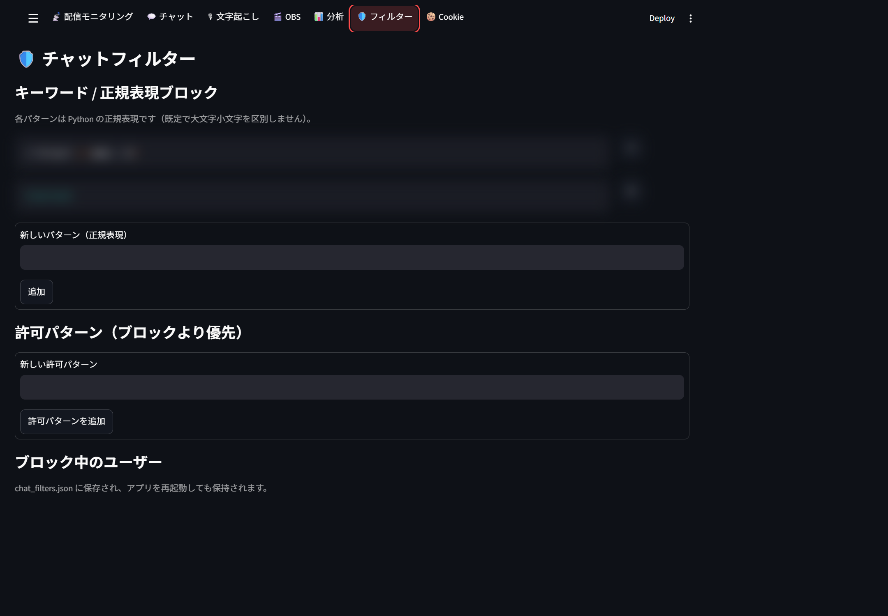

1. 上部の **フィルター** を選びます。
2. **新しいパターン（正規表現）** にブロック条件を入力して **追加** を押します。
3. ブロックより優先させる条件は **許可パターン** に追加します。
4. **ブロック中のユーザー** で対象を確認し、解除する場合は対象行の **✕** を押します。
5. 必要なら **ユーザーID / チャンネルIDでブロック** を使います。

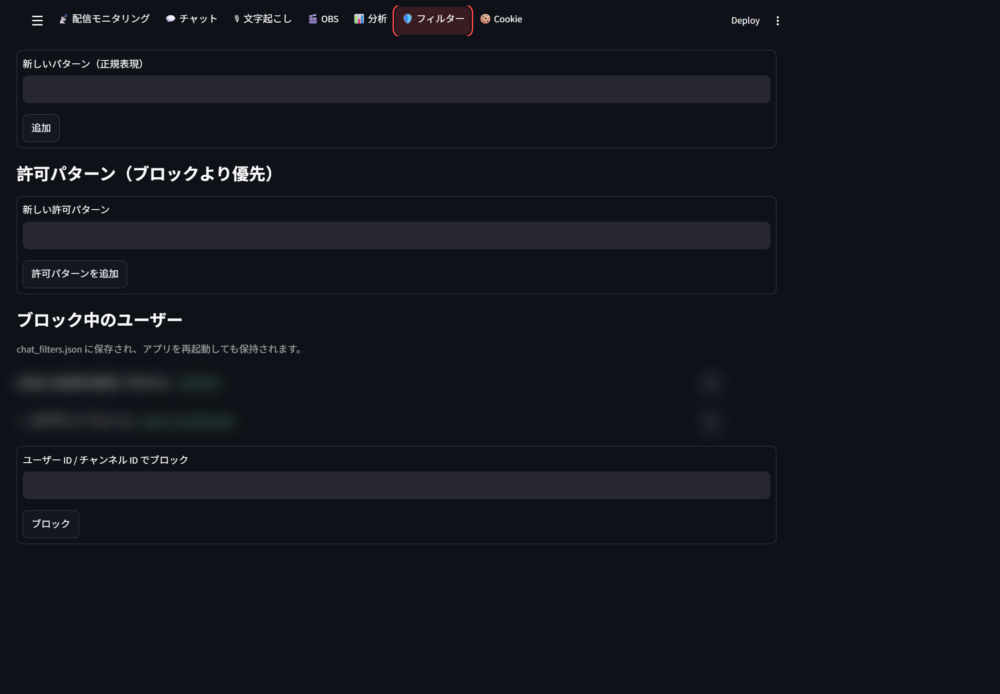

保存済みルール・ユーザー情報は画像では伏せています。撮影のためにルールを変更・削除してはいません。正規表現は単なる文字列検索とは異なるため、最初は小さい条件で動作を確認してください。

## 手順8（任意）：ライブ音声を文字起こしする

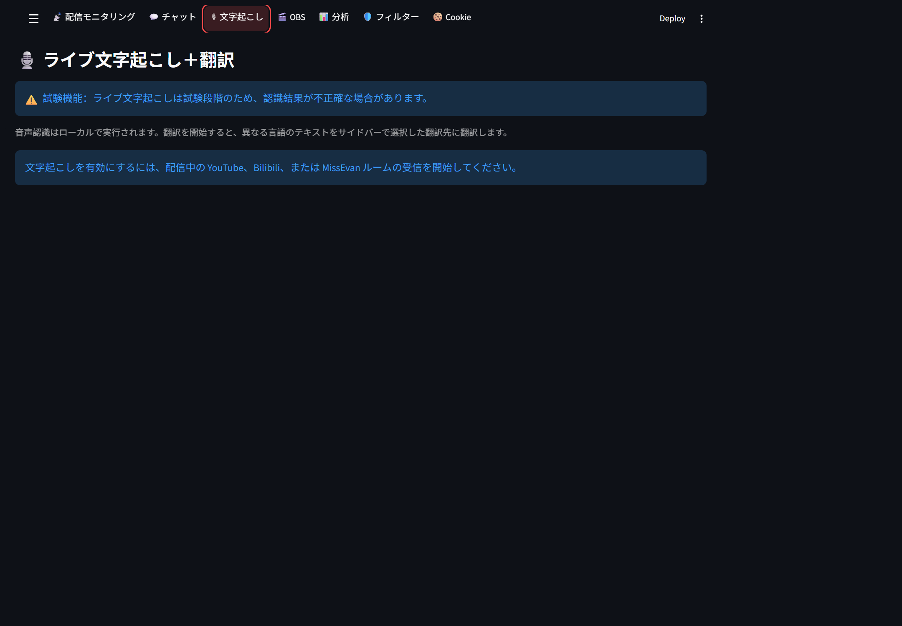

1. 管理者が `.env` に次を設定し、ダッシュボードを再起動します。

   ```env
   TRANSCRIPTION_ENABLED=true
   ```

2. FFmpeg をインストールし、実行環境の `PATH` から利用できるようにします。
3. **配信モニタリング** で、配信中のルームの受信を開始します。
4. 上部の **文字起こし** を開き、対象プラットフォームと Whisper モデルを選びます。
5. **文字起こし＋翻訳を開始** を押します。モデルは初回使用時にダウンロードされます。
6. チャット画面へ戻ると、実行中は最近3件の文字起こしを上部のプレビューで確認できます。
7. 不要になったら文字起こしページで停止します。

画像は受信開始前のため、対象選択や認識結果はまだ表示されていません。文字起こしは試験機能で、認識誤りがあり、CPU・メモリーを使用します。遅い場合は小さいモデルを使うか停止して比較してください。`TRANSCRIPTION_ENABLED=false` に戻して再起動すると、入口とプレビューを非表示にできます。通常のチャット翻訳は引き続き利用できます。

## よくある困りごと

| 症状 | 確認すること |
|---|---|
| チャットが空 | モニタリング側で受信を開始したか、配信中か、サイトの表示チェックがオンか |
| 読み上げボタンがない | ☰ 内の読み上げを有効にしたか |
| 最新メッセージへ追従しない | 最新位置に戻るか、矢印ボタンを押す |
| 訳文がまだない | 翻訳を開始したか、翻訳先を選んだか。原文表示後に訳文が追加されるまで待つ |
| 文字起こし入口がない | `TRANSCRIPTION_ENABLED=true` に設定し、再起動したか |
| 送信・スタンプが使えない | 該当サイトのログイン、受信状態、スタンプ利用条件を確認する |
| OBS オーバーレイが出ない | プログラムが動いているか、画面にエラーがないか、コピーした URL とポートが正しいか |
| 操作が重い | 文字起こしを停止して比較し、最大表示メッセージ数を減らす。翻訳完了待ちと原文受信の遅延を区別する |

詳しい機能・設定項目は [日本語 README](README.ja.md) を参照してください。
