# 🐣 Easy setup guide (Windows)

**English** | [简体中文](GUIDE.zh-CN.md) | [日本語](GUIDE.ja.md)

This guide is for people who have never installed a program like this before. You only need to **download, unzip and double-click**. Everything else is automatic.

> Screenshots show the English UI with no saved logins or active listeners, so chat and charts are empty. Room covers are hidden and saved filter details are blurred for privacy.

## What you need

- A Windows 10 or Windows 11 computer
- An internet connection
- About 10 minutes the first time (later it starts in a few seconds)

## Step 1 — Download

1. Open this link: <https://github.com/OneJan111/multi-platform-chat/archive/refs/heads/main.zip>
   The download starts by itself. (Or open <https://github.com/OneJan111/multi-platform-chat>, click the green **Code** button, then **Download ZIP**.)
2. Open your **Downloads** folder (press the Windows key, type `Downloads`, press Enter).
3. **Right-click** the file `multi-platform-chat-main.zip` → **Extract All…** → **Extract**.
   A new folder `multi-platform-chat-main` opens.
   > ⚠️ Don't skip this step. The program does not work from inside the ZIP file.
4. Optional: move the `multi-platform-chat-main` folder somewhere easy to find, such as **Documents**.

## Step 2 — Start it

1. In the `multi-platform-chat-main` folder, **double-click `Start Dashboard`**. Its icon is a little window with a gear. If Windows shows file extensions, it is called `Start_Dashboard.bat`.
2. If a blue box says **"Windows protected your PC"**, click **More info** → **Run anyway**.
   This happens because the file came from the internet. It is a plain text script; you can right-click it → **Edit** to read it.
3. A **black window** opens. This is the dashboard program.
   - The first time, it installs Python and the parts it needs. **Lots of text scrolls by — that is normal.** It takes 3–10 minutes.
   - If Windows asks *"Do you want to allow this app to make changes to your device?"*, click **Yes**.
4. Your web browser opens the dashboard by itself at <http://localhost:8501>.
5. A **Live Chat Dashboard** shortcut is added to your desktop. Use it next time.

> 🖤 **Keep the black window open** while you use the dashboard. You can minimise it (the `_` button at its top right), but don't close it.

## Every day

| I want to… | Do this |
|---|---|
| Start the dashboard | Double-click **Live Chat Dashboard** on the desktop |
| Stop the dashboard | Close the black window (the ✕ at its top right) |
| Get the page back after closing the browser tab | Double-click the desktop shortcut again, or open <http://localhost:8501> |

## Step 3 — Read chat

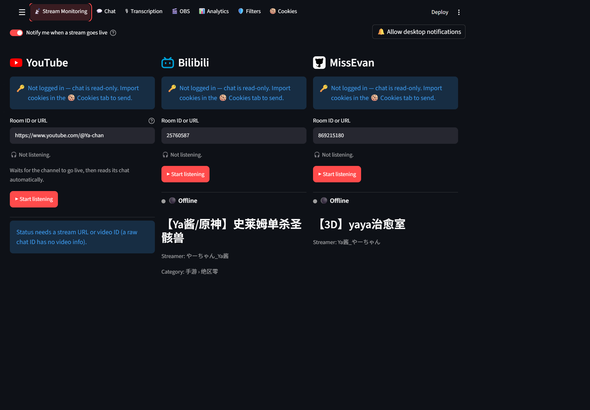

1. Click the **📡 Stream Monitoring** tab.
2. Under **YouTube**, **Bilibili** or **MissEvan**, paste your channel link or room number into **Room ID or URL**.
3. Click **▶ Start listening**. The chat appears in the **💬 Chat** tab.

Reading chat needs no login.

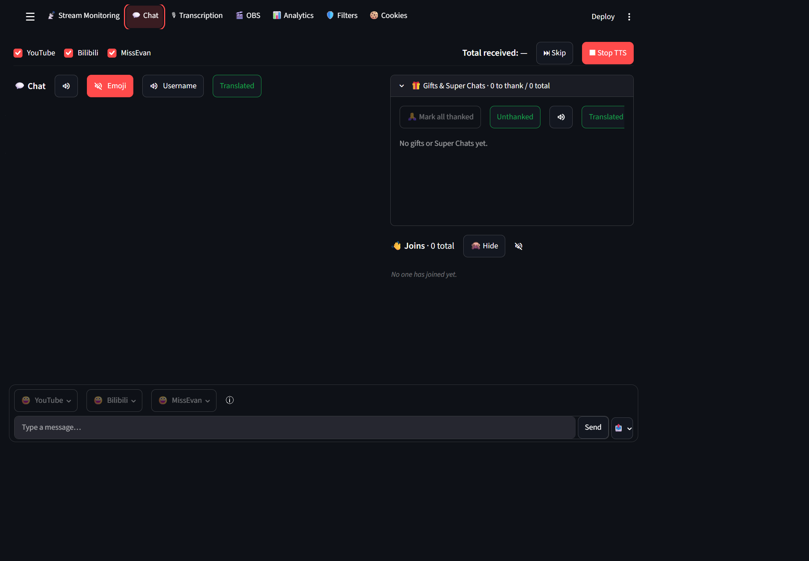

Use the page buttons across the top, beside Deploy, to switch pages. On narrow screens, scroll that row sideways. The **☰** button opens settings.

Chat follows the latest messages automatically. Scrolling back pauses following; return to the latest position or press the arrow to resume. Click a gift's content area to toggle its thanked state, or use **Unthanked** to show only outstanding gifts.

The message display limit excludes gifts and Super Chats. **☰ → Clear chat history** removes ordinary chat, joins, and thanked gifts/Super Chats, while keeping unthanked items.

### Translation and reading aloud

For a lighter dashboard, open **☰ → Feed display** and turn off **Render emoji and gift images**. Emoji codes and gift text/counts/amounts remain visible. Standalone OBS overlays and the sending sticker picker are unchanged. `RENDER_CHAT_IMAGES=true` sets the default; use `false` and restart for a lightweight default. Saved browser preferences take priority.

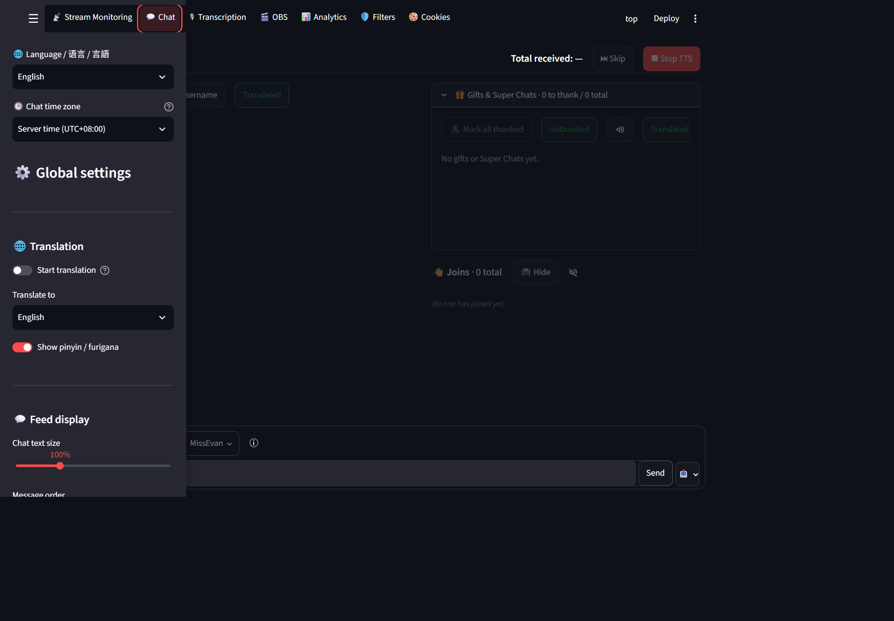

1. Open **☰**, choose **Translate to**, then enable **Start translation**.
2. Original messages appear first; translations are added when ready.
3. Scroll down to **Enable TTS** to enable reading aloud.

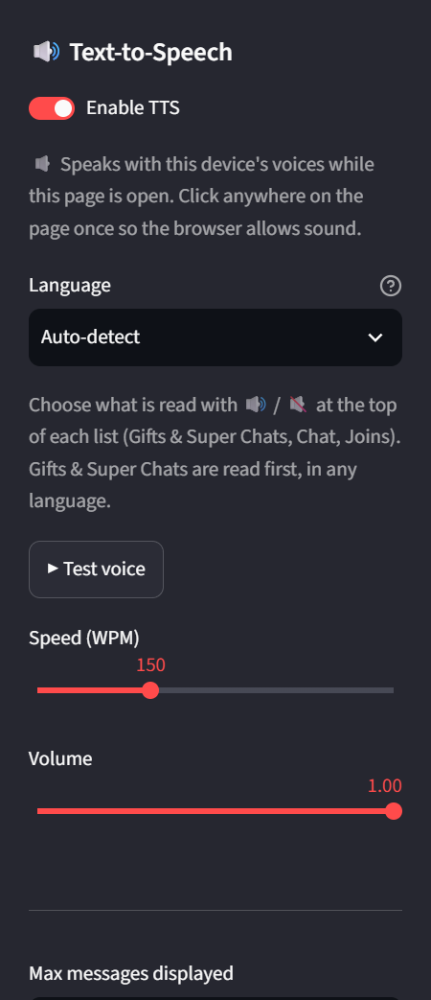

4. Choose the voice language, speed and volume, then use **Test voice**.
5. Return to Chat. Speaker buttons mute each feed; **Emoji** and **Username** control what is skipped.
6. Use the chat or gift feed's **Translated** button to read translations. Solid green means on; a green outline means off. These reading controls appear only when TTS is enabled.

## Optional — Transcribe and translate live audio

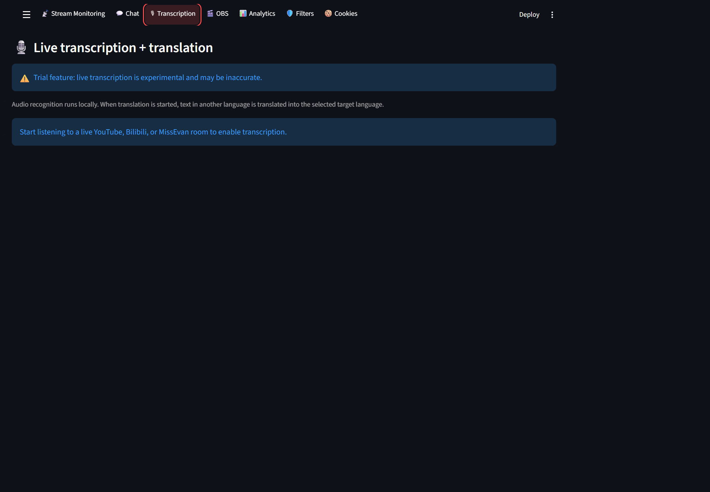

This optional page is hidden by default. Set `TRANSCRIPTION_ENABLED=true` in `.env` and restart the dashboard to show it. The screenshot is taken before listening starts, so source/model controls and results are not yet available.

1. Start listening to a live stream in **📡 Stream Monitoring**.
2. Install FFmpeg and add it to Windows `PATH` if it is not already available.
3. Open **🎙 Transcription**, choose one active platform and a Whisper model, then click **▶ Start transcription + translation**.

Audio recognition runs locally. The selected Whisper model is downloaded the first time you use it, so that first start needs an internet connection and may take a while. In the sidebar, choose **Translate to** and turn on **Start translation** to translate both chat and transcription when their detected language differs from the selected target. Transcription stops when you stop or switch the selected platform's listener.

## Step 4 — Log in so you can send chat (optional)

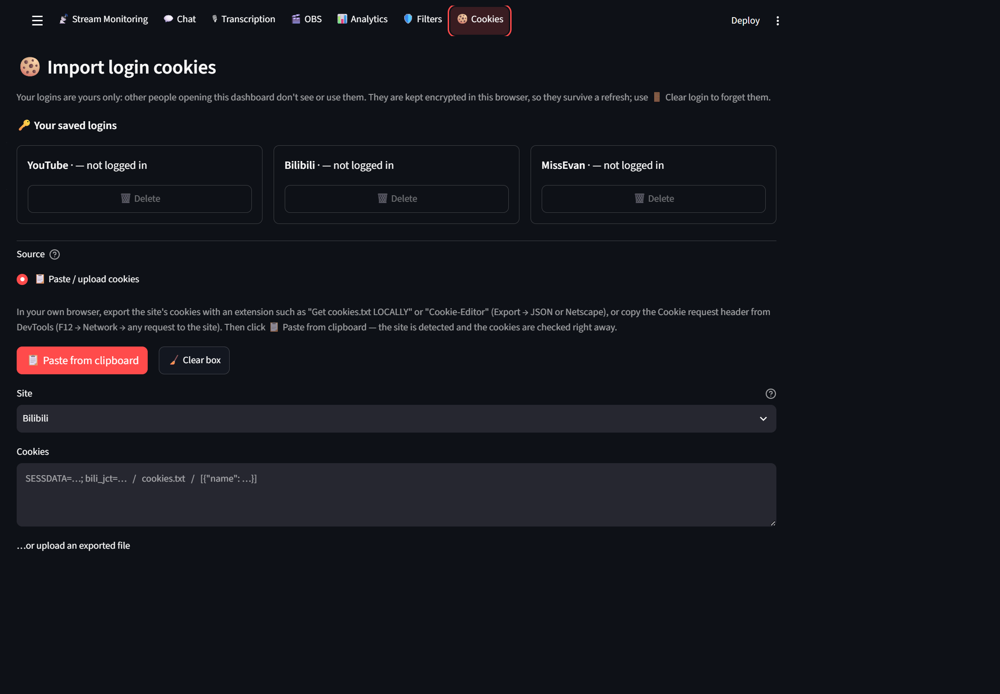

1. Log in to YouTube / Bilibili / MissEvan in your usual browser (Chrome, Edge or Firefox).
2. In the dashboard, open the **🍪 Cookies** tab.
3. Choose **📋 Paste / upload cookies**: export your site's cookies from your own browser with a cookie-export extension (**Export → JSON** or Netscape format). Paste them into the box or upload the file, select the site and click **Read cookies**. Alternatively, **📋 Paste from clipboard** detects the site and checks the cookies immediately. Follow the confirmation prompts.
   - If **🧭 Browser on this computer** is available in your environment, you can select your browser and site there instead.
4. To log out, click **🗑️ Delete** next to the site under **🔑 Your saved logins** (or **🗑️ Delete all logins**).

To send chat or room stickers to MissEvan, the imported account must be allowed to chat in the room; MissEvan's web client requires a bound phone number. Use the MissEvan picker beside the message box to browse room stickers (click one to send it immediately) or click a preset kaomoji to add it to the message box and review or edit it before sending. The picker is enabled only while listening to that room. If sending fails, import fresh MissEvan cookies.

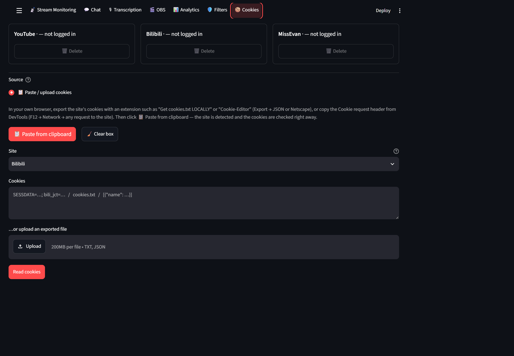

Treat cookies like passwords: never share them in chat, screenshots or public repositories. After importing, start listening to the room, return to **Chat**, check the **📤** send targets, enter your message and press **Send**.

## Step 5 — Show chat on your stream in OBS

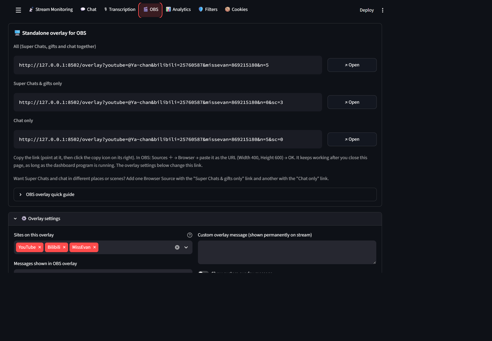

1. In the dashboard, open the **🎬 OBS** tab. At the top is **🖥️ Standalone overlay for OBS** with a link.
2. Point at the link and click the **copy** icon on its right.
3. In OBS: in the **Sources** box click **＋** → **Browser** → **OK**.
4. Paste the link into **URL**. Set **Width** `400` and **Height** `600`, then click **OK**.
5. Drag and resize the chat box in the OBS preview where you want it.

The overlay keeps working as long as the black window is open, even if you close the dashboard page.

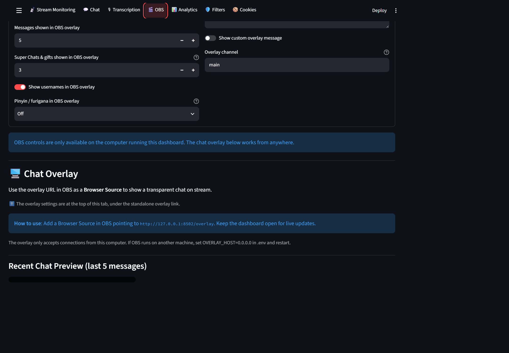

Use separate **Super Chats & gifts only** and **Chat only** links for separate browser sources. Expand overlay settings to choose sites, message counts and username display.

The overlay URL responded successfully on port 8502 during capture; OBS Studio rendering was not tested. Local OBS controls are unavailable in the capture environment. If you see a port-in-use error, check for another dashboard instance or change `OVERLAY_PORT` in `.env`, restart and copy the new URL.

## Step 6 — Check analytics

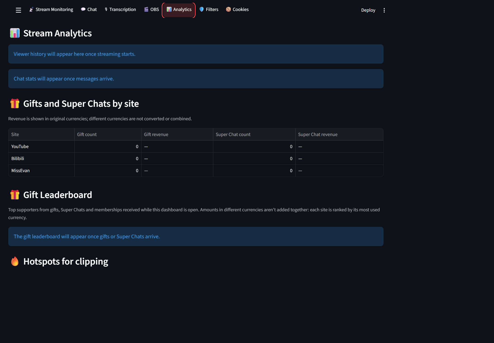

1. Start listening, then open **Analytics**.
2. Check viewer history, chat statistics and per-site gift/Super Chat counts and revenue.
3. Scroll down for supporter rankings and clip hotspots.

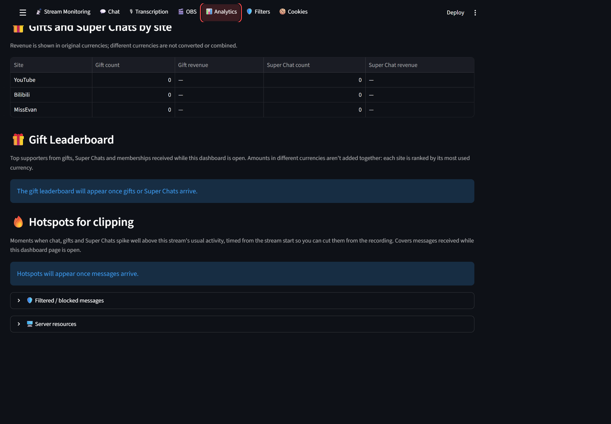

Only data received while the dashboard is running is included. Different currencies are not converted or added together. Empty charts and rankings are expected before messages arrive.

## Step 7 — Manage filters

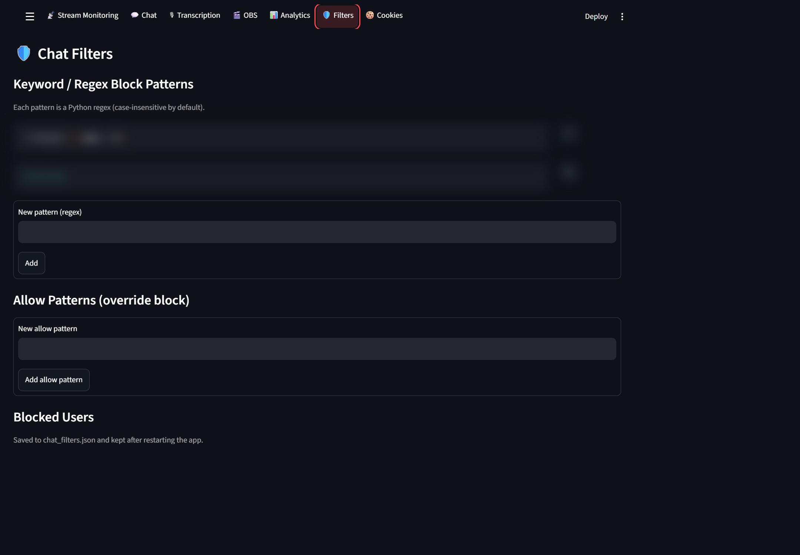

1. Open **Filters** and add a regular-expression block pattern.
2. Add an allow pattern when a rule should take priority over blocking.
3. Review blocked users; use **✕** beside an entry to unblock it.
4. Use the user/channel ID field to block a specific account.

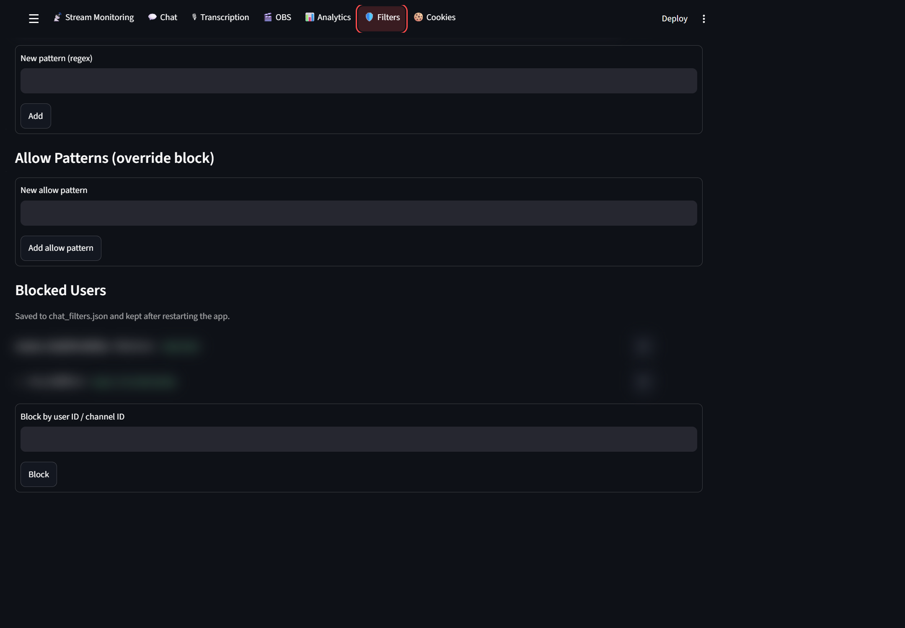

Saved rules and identifiers are blurred in these screenshots; they were not changed for capture. Test regular expressions with a small rule first.

## Optional settings

Most people never need this. The settings file is `.env` in the `multi-platform-chat-main` folder (it is created on the first start).
To change it: right-click `.env` → **Open with** → **Notepad**, edit, save, then close the black window and start the dashboard again.

- **OBS remote control** (start/stop stream, scenes) — in OBS open **Tools → WebSocket Server Settings**, tick **Enable WebSocket server**, click **Show Connect Info** and copy the password. In `.env`, put it after `OBS_PASSWORD=`. Then turn on **Connect to OBS** in the 🎬 OBS tab.
- **Default rooms** — `YOUTUBE_CHANNEL=`, `BILIBILI_ROOM_ID=`, `MISSEVAN_ROOM_ID=`.
- **Room status refresh** — `ROOM_STATUS_POLL_INTERVAL=60` (seconds, minimum 1) independently refreshes room status, titles and viewer counts, and sets the YouTube channel-watch interval. Restart after changing it. It does not automatically start chat listeners; go-live alerts may be delayed by one interval plus request time.
- **Chat translation** — the app tries Index-Translate first and falls back to Google. The built-in streaming glossary keeps terms such as *舰长*, *醒目留言*, *上舰* and *弹幕* consistent. To use Google directly, set `INDEX_TRANSLATE_API_BASE=` in `.env`. When translation is enabled, chat text is sent to the translation service.

## Updating to a new version

1. Close the black window.
2. Download and extract the ZIP again (Step 1).
3. Copy everything from the new `multi-platform-chat-main` folder **into your old folder**, and choose **Replace the files in the destination**.
   This keeps your settings (`.env`), your logins (`.login_secret`) and your blocked users (`chat_filters.json`).
4. Start the dashboard. If something new is needed, it installs it automatically.

## Problems?

| What you see | What to do |
|---|---|
| "Windows protected your PC" | Click **More info** → **Run anyway**. |
| The black window opens and closes immediately | Make sure you extracted the ZIP (Step 1, point 3) and are not running it from inside the ZIP. |
| "Python could not be installed automatically" | A web page opens. Click the yellow **Download Python** button and run it. On the first screen **tick "Add python.exe to PATH"**, then click **Install Now**. Then double-click `Start Dashboard` again. |
| "Installing the parts failed" | Check your internet connection and double-click `Start Dashboard` again. It continues where it stopped. |
| The browser didn't open | Open <http://localhost:8501> yourself. |
| "The dashboard is already running" | It's already open — the window opens the page for you. To restart, close the black window first. |
| The page says "Connection error" | The black window was closed. Start the dashboard again. |
| The OBS overlay is empty | The black window must be open, and the room in the link must be live with chat. |
| Something else is wrong | Close the black window, delete the `.venv` folder inside `multi-platform-chat-main`, and start again. This reinstalls everything (your settings and logins are kept). |

More details for advanced users are in the [README](README.md).
