# 🐣 简易安装指南（Windows）

[English](GUIDE.md) | **简体中文** | [日本語](GUIDE.ja.md)

本指南写给从没装过这类程序的人。你只需要 **下载、解压、双击**，其余全部自动完成。

> 截图使用简体中文界面，未登录、未开始监听，因此弹幕和图表为空。直播间封面已隐藏，已保存的过滤规则和用户信息已模糊处理。

## 需要准备

- 一台 Windows 10 或 Windows 11 电脑
- 能上网
- 第一次大约 10 分钟（之后几秒就能启动）

## 第 1 步 — 下载

1. 打开这个链接：<https://github.com/OneJan111/multi-platform-chat/archive/refs/heads/main.zip>
   会自动开始下载。（也可以打开 <https://github.com/OneJan111/multi-platform-chat>，点绿色的 **Code** 按钮，再点 **Download ZIP**。）
2. 打开 **下载** 文件夹（按 Windows 键，输入 `下载` 或 `Downloads`，回车）。
3. **右键** 文件 `multi-platform-chat-main.zip` → **全部解压缩…** → **解压**。
   会打开一个新文件夹 `multi-platform-chat-main`。
   > ⚠️ 不要跳过这一步。在 ZIP 文件里面直接运行是不行的。
4. 可选：把 `multi-platform-chat-main` 文件夹移到好找的地方，比如 **文档**。

## 第 2 步 — 启动

1. 在 `multi-platform-chat-main` 文件夹里，**双击 `Start Dashboard`**（图标是带齿轮的小窗口；如果显示扩展名，则叫 `Start_Dashboard.bat`）。
2. 如果出现蓝色窗口 **“Windows 已保护你的电脑”**，点 **更多信息** → **仍要运行**。
   这是因为文件来自网络。它只是一个文本脚本，可以右键 → **编辑** 查看内容。
3. 会打开一个 **黑色窗口**，这就是仪表板程序。
   - 第一次会自动安装 Python 和所需组件。**会滚动很多文字，这是正常的**，需要 3–10 分钟。
   - 如果 Windows 询问 *“你要允许此应用对你的设备进行更改吗？”*，点 **是**。
4. 浏览器会自动打开仪表板：<http://localhost:8501>。
5. 桌面上会多一个 **Live Chat Dashboard** 快捷方式，下次直接用它。

> 🖤 使用期间 **不要关闭黑色窗口**。可以最小化（右上角的 `_`），但不要关掉。

## 日常使用

| 我想… | 这样做 |
|---|---|
| 启动仪表板 | 双击桌面上的 **Live Chat Dashboard** |
| 关闭仪表板 | 关闭黑色窗口（右上角的 ✕） |
| 不小心关了浏览器标签页 | 再双击一次桌面快捷方式，或打开 <http://localhost:8501> |

## 第 3 步 — 读取弹幕

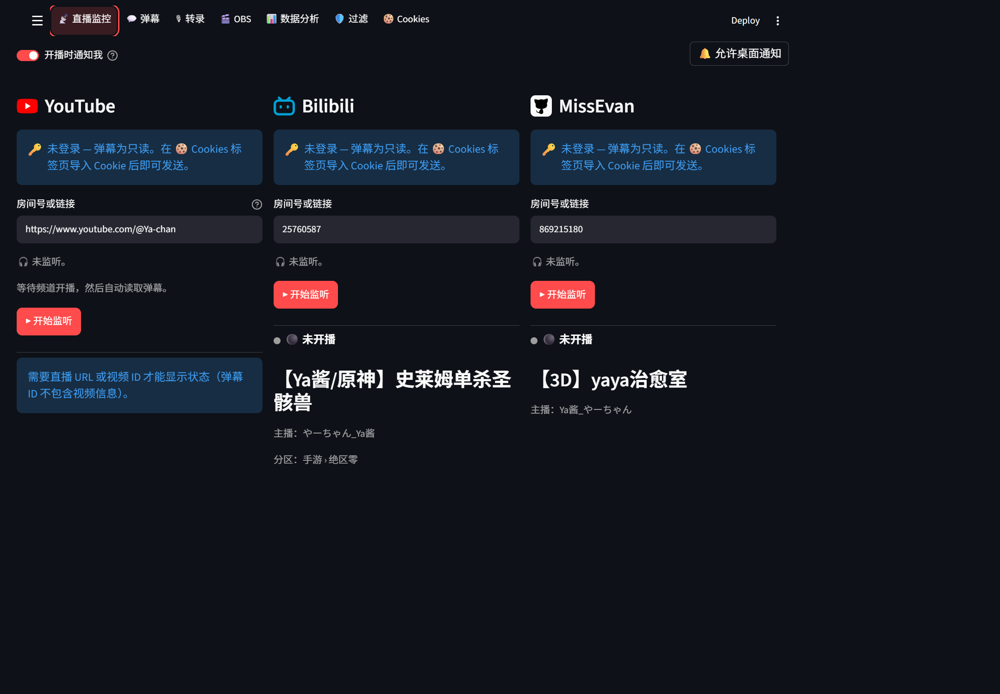

1. 点 **📡 直播监控** 标签页。
2. 在 **YouTube**、**Bilibili** 或 **猫耳FM** 下面的 **房间号或链接** 里粘贴你的频道链接或房间号。
3. 点 **▶ 开始监听**，弹幕会显示在 **💬 弹幕** 标签页。

读取弹幕不需要登录。

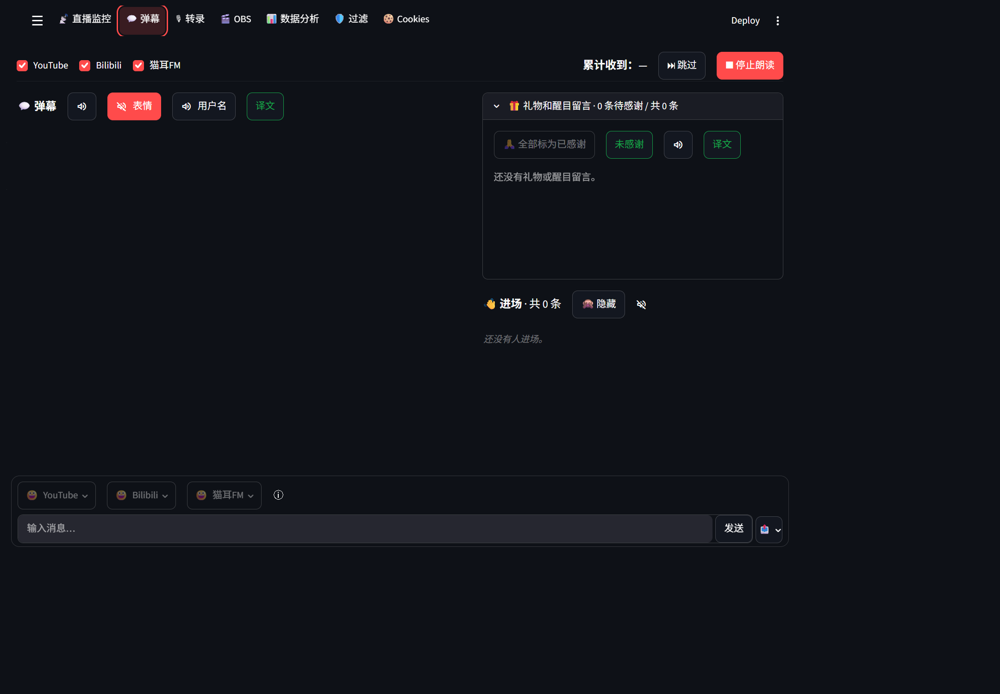

页面入口位于顶部，与 Deploy 同一排。窄屏可横向滚动入口栏。左上角 **☰** 用于打开设置。

弹幕会自动跟随最新消息；向历史消息滚动会暂停跟随，返回最新位置或点击箭头可恢复。点击礼物内容区域可切换已感谢状态，**未感谢** 可只显示尚未感谢的礼物。

“最多显示消息数”不包含礼物和醒目留言。☰ 中的“清空弹幕记录”会清除普通弹幕、进场记录及已感谢的礼物和醒目留言，未感谢的项目会保留。

### 翻译和语音朗读

轻量显示：打开 **☰ → 列表显示**，关闭 **显示表情和礼物图片**。表情代码及礼物名称、数量、金额仍保留，不影响 OBS 独立弹幕层和发送用的表情选择器。环境参数 `RENDER_CHAT_IMAGES=true` 默认开启；改成 `false` 并重启可默认关闭，浏览器已保存的设置优先。

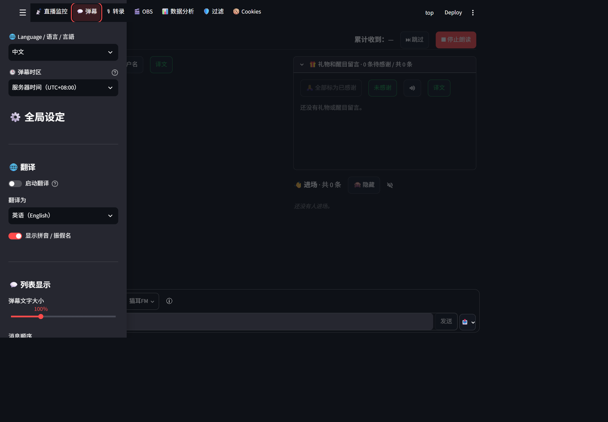

1. 打开 **☰**，选择 **翻译为** 的目标语言，再打开 **启动翻译**。
2. 弹幕原文先显示，译文完成后再补上。
3. 向下滚动，打开 **启用语音朗读**。

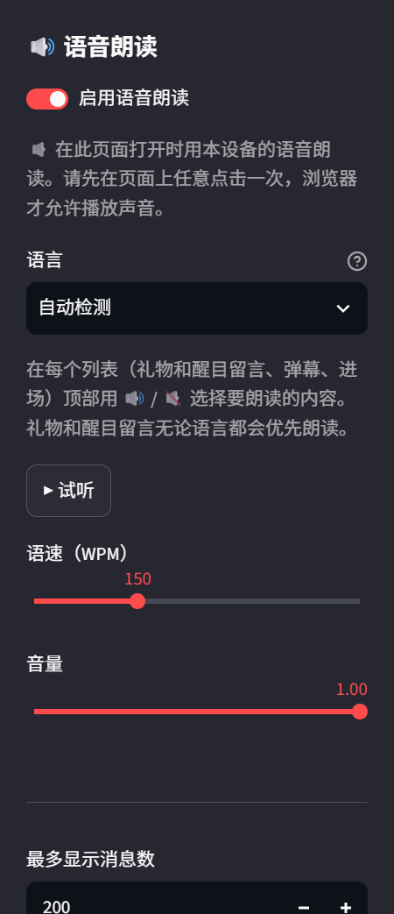

4. 选择语言、语速和音量，点击 **试听** 检查声音。
5. 返回弹幕页面，用各列表的扬声器按钮切换静音，使用 **表情** 和 **用户名** 控制是否跳过这些内容。
6. 弹幕和礼物列表分别有 **译文** 按钮，用于阅读弹幕译文或醒目留言译文。绿色填充表示开启，绿色边框表示关闭。朗读控制按钮只在启用语音朗读后显示。

## 可选 — 实时转录和翻译语音

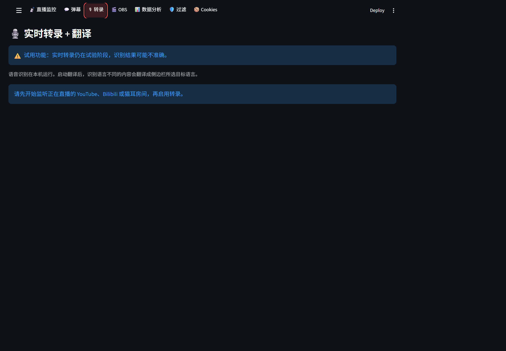

转录页面默认隐藏。先在 `.env` 设置 `TRANSCRIPTION_ENABLED=true`，再重启仪表板。截图为未开始监听的状态，因此尚未显示来源、模型选择和识别结果。

1. 在 **📡 直播监控** 中开始监听一个正在直播的频道或房间。
2. 如果系统找不到 FFmpeg，请安装 FFmpeg 并将其添加到 Windows `PATH`。
3. 打开 **🎙 转录**，选择一个正在监听的平台和 Whisper 模型，再点 **▶ 开始转录 + 翻译**。

语音识别在本机运行。所选 Whisper 模型会在首次使用时下载，因此首次启动需要联网，可能需要等待一段时间。在侧边栏选择 **翻译为** 目标语言并打开 **启动翻译** 后，弹幕和转录中与该语言不同的内容都会翻译成所选语言。停止或切换所选平台的监听时，转录也会停止。

## 第 4 步 — 登录以便发送弹幕（可选）

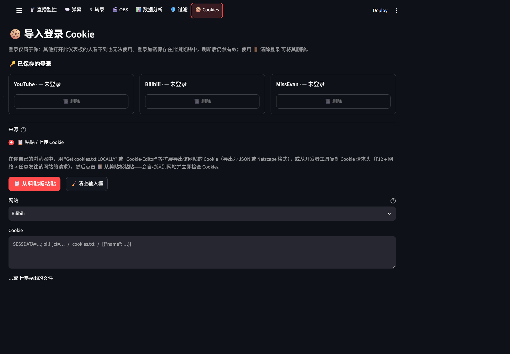

1. 在你平时用的浏览器（Chrome、Edge 或 Firefox）里登录 YouTube / B站 / 猫耳FM。
2. 在仪表板中打开 **🍪 Cookies** 标签页。
3. 选择 **📋 粘贴 / 上传 Cookie**：在自己的浏览器中用 Cookie 导出扩展导出该网站的 Cookie（JSON 或 Netscape 格式），粘贴到输入框或上传文件，选择网站后点 **读取 Cookie**。也可以点 **📋 从剪贴板粘贴**，自动识别网站并立即检查 Cookie，然后按提示确认。
   - 如果运行环境提供 **🧭 本机浏览器**，也可以在那里选择浏览器和网站来读取。
4. 要退出登录，在 **🔑 已保存的登录** 中点该网站的 **🗑️ 删除**（或 **🗑️ 删除所有登录**）。

向猫耳FM 发送弹幕或房间表情时，导入的账号必须有该直播间的发言资格；猫耳FM 网页端要求账号已绑定手机号。监听对应房间时，可在留言框旁的猫耳FM 选择器中浏览房间表情包（点击表情会立即发送），或点击预设颜文字将其添加到留言框，检查或编辑后再发送。发送失败的话，请重新导入最新的猫耳FM Cookie。

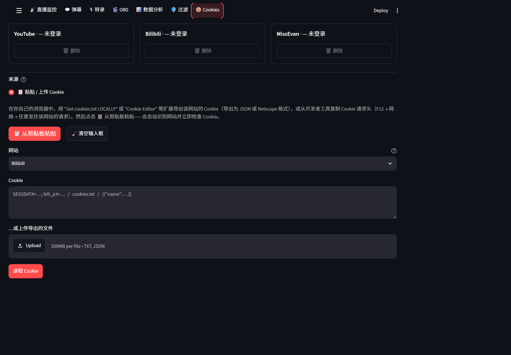

Cookie 应像密码一样保管，不要放进聊天、截图或公开仓库。导入后开始监听对应房间，返回 **弹幕**，检查 **📤** 中的发送目标，输入内容后点击 **发送**。

## 第 5 步 — 在 OBS 直播画面上显示弹幕

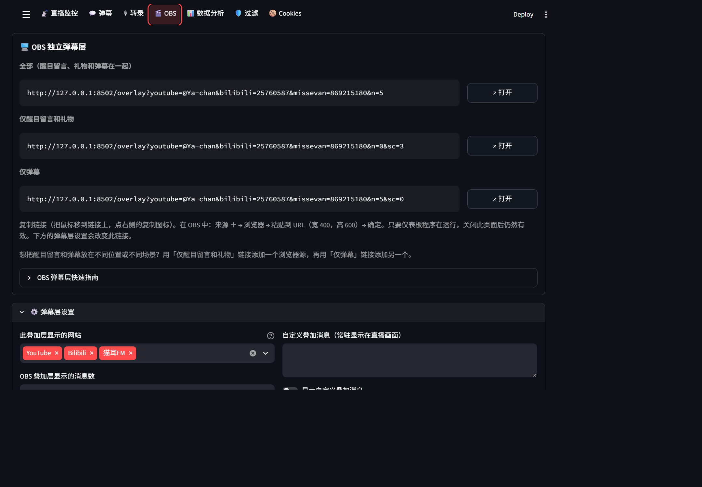

1. 在仪表板中打开 **🎬 OBS** 标签页，最上方是 **🖥️ OBS 独立弹幕层** 和一个链接。
2. 把鼠标移到链接上，点右侧的 **复制** 图标。
3. 在 OBS 的 **来源** 框中点 **＋** → **浏览器** → **确定**。
4. 把链接粘贴到 **URL**，**宽度** 填 `400`，**高度** 填 `600`，点 **确定**。
5. 在 OBS 预览中拖动、缩放弹幕框到合适的位置。

只要黑色窗口开着，即使关闭仪表板页面，弹幕层也会继续工作。

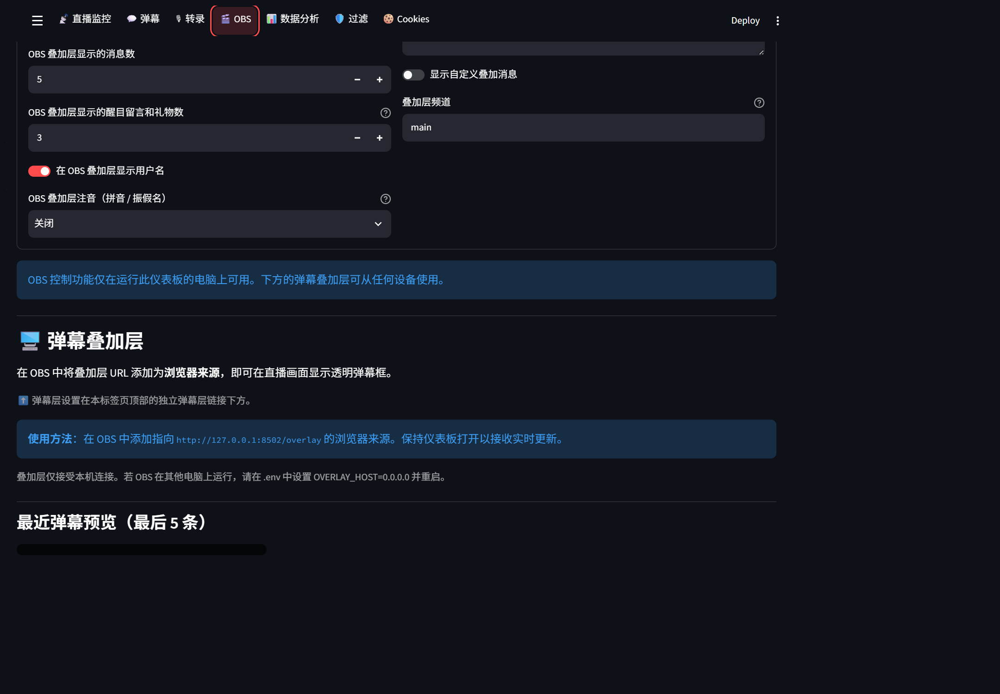

想分别摆放礼物和普通弹幕，可用“仅醒目留言和礼物”和“仅弹幕”的链接建立两个浏览器来源。展开弹幕层设置可选择显示网站、消息数量和用户名。

截图时已确认端口8502的弹幕层 URL 正常响应，但未在 OBS Studio 内验证显示效果。截图环境不提供本机专用的 OBS 控制。如果出现端口被占用错误，请检查其他仪表板实例，或在 `.env` 修改 `OVERLAY_PORT`，重启后重新复制链接。

## 第 6 步 — 查看数据分析

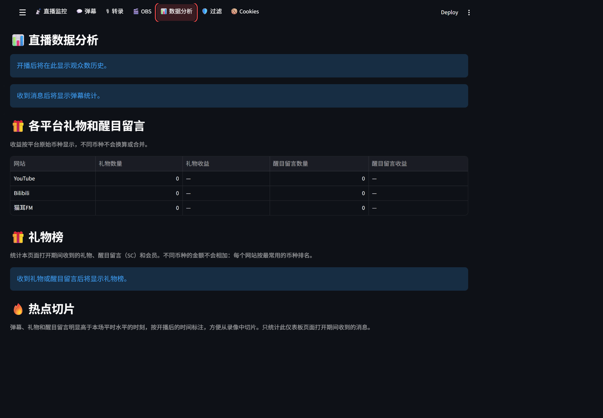

1. 开始监听后打开 **数据分析**。
2. 查看观众数历史、弹幕统计，以及各网站的礼物和醒目留言数量、收益。
3. 向下滚动查看礼物排行榜和切片热点。

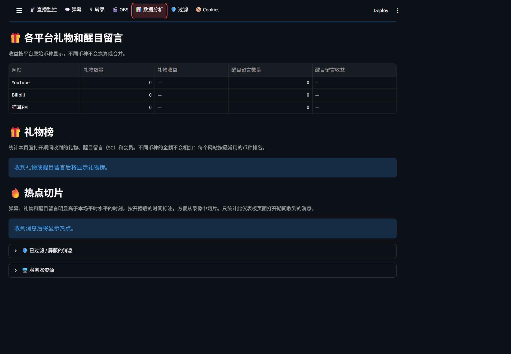

统计仅包含仪表板运行期间收到的数据。不同货币不会换算或合并。尚未收到消息时，没有图表或排行榜是正常的。

## 第 7 步 — 管理过滤规则

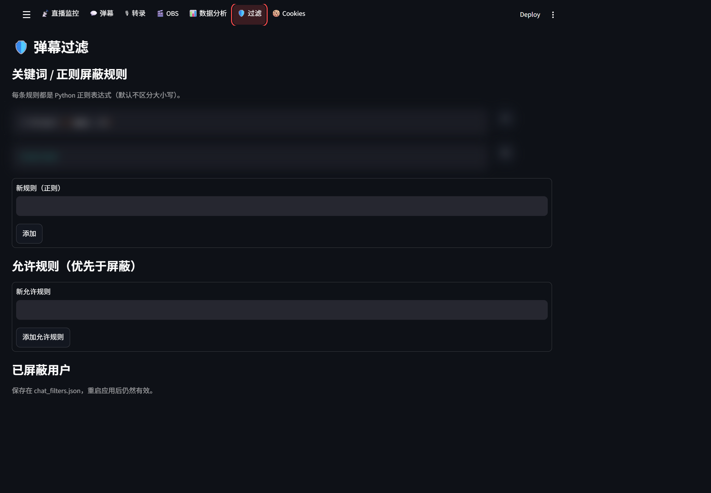

1. 打开 **过滤**，添加正则表达式屏蔽规则。
2. 需要优先放行的内容可添加到允许规则中。
3. 查看已屏蔽用户，点击对应项的 **✕** 可解除屏蔽。
4. 使用用户 ID / 频道 ID 输入框屏蔽指定账号。

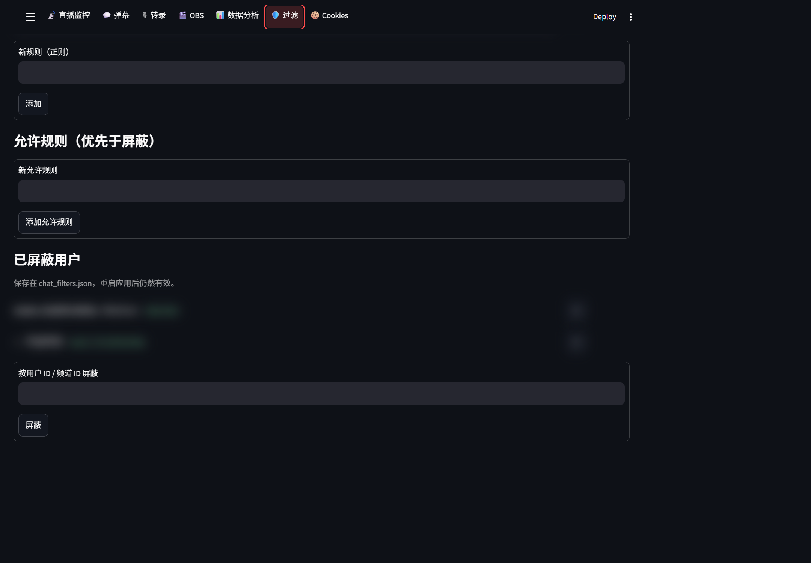

截图中的保存规则和用户标识已模糊处理，拍摄时没有修改或删除。正则表达式不等同于普通文字搜索，建议先用简单规则检查效果。

## 可选设置

大多数人不需要改。设置文件是 `multi-platform-chat-main` 文件夹中的 `.env`（第一次启动时自动创建）。
修改方法：右键 `.env` → **打开方式** → **记事本**，修改并保存，然后关闭黑色窗口再重新启动。

- **OBS 遥控**（开始/停止直播、切换场景）——在 OBS 中打开 **工具 → WebSocket 服务器设置**，勾选 **开启 WebSocket 服务器**，点 **显示连接信息** 并复制密码，填到 `.env` 中 `OBS_PASSWORD=` 后面。然后在 🎬 OBS 标签页打开 **连接 OBS**。
- **默认房间**——`YOUTUBE_CHANNEL=`、`BILIBILI_ROOM_ID=`、`MISSEVAN_ROOM_ID=`。
- **房间状态查询间隔**——`ROOM_STATUS_POLL_INTERVAL=60`（秒，最小为 1），控制房间状态、标题、人数的独立定时更新，以及 YouTube 开播等待检查。修改后重启；不会自动启动弹幕监听。开播通知可能延迟一个查询周期加上网络请求耗时。
- **默认显示消息数**——`MAX_CHAT_DISPLAY=50`（范围 10–200），同时控制弹幕和转录页面的显示上限；弹幕页顶部的转录预览仍为最近 3 条。修改后重启；浏览器已保存的有效个人设置优先，也可在 ☰ 中调整“最多显示消息数”。
- **弹幕翻译**——程序优先使用 Index-Translate，失败时回退到 Google。内置直播术语表会统一“舰长”“醒目留言”“上舰”“弹幕”等词。若要直接使用 Google，在 `.env` 中设置 `INDEX_TRANSLATE_API_BASE=`。启用翻译时，弹幕文本会发送给翻译服务。

## 更新到新版本

1. 关闭黑色窗口。
2. 重新下载并解压 ZIP（第 1 步）。
3. 把新的 `multi-platform-chat-main` 文件夹里的所有内容 **复制到旧文件夹中**，选择 **替换目标中的文件**。
   这样会保留你的设置（`.env`）、登录（`.login_secret`）和屏蔽用户（`chat_filters.json`）。
4. 启动仪表板。如果需要新组件，会自动安装。

## 遇到问题？

| 看到的情况 | 解决方法 |
|---|---|
| “Windows 已保护你的电脑” | 点 **更多信息** → **仍要运行**。 |
| 黑色窗口一闪就关了 | 确认已经解压 ZIP（第 1 步第 3 点），不要在 ZIP 里面运行。 |
| “Python could not be installed automatically” | 会打开一个网页。点黄色的 **Download Python** 按钮并运行，第一个画面 **勾选 “Add python.exe to PATH”**，再点 **Install Now**。完成后再双击 `Start Dashboard`。 |
| “Installing the parts failed” | 检查网络，再双击 `Start Dashboard`，会从中断处继续。 |
| 浏览器没有自动打开 | 自己打开 <http://localhost:8501>。 |
| “The dashboard is already running” | 已经在运行了，窗口会帮你打开页面。要重启请先关闭黑色窗口。 |
| 页面显示 “Connection error” | 黑色窗口被关掉了，重新启动仪表板。 |
| OBS 弹幕层是空的 | 黑色窗口必须开着，链接中的房间必须正在直播且有弹幕。 |
| 其他问题 | 关闭黑色窗口，删除 `multi-platform-chat-main` 里的 `.venv` 文件夹，再重新启动。会重新安装全部组件（设置和登录会保留）。 |

进阶用户的详细说明请看 [README](README.zh-CN.md)。
